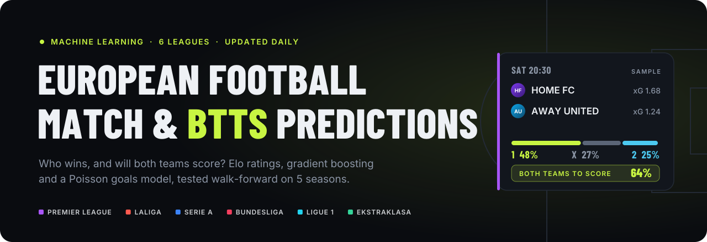
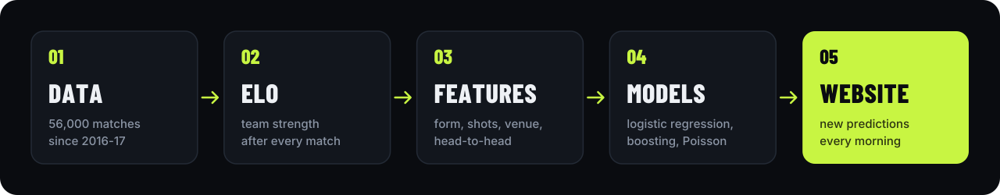

<p align="center">
  <a href="https://jabolos10.github.io/European_Football_Match_and_BTTS_Predictions/">
    
  </a>
</p>

<p align="center">
  <a href="https://jabolos10.github.io/European_Football_Match_and_BTTS_Predictions/"></a>
  <a href="https://github.com/jabolos10/European_Football_Match_and_BTTS_Predictions/actions/workflows/update.yml"></a>
  
  
</p>

<p align="center">
  <b><a href="https://jabolos10.github.io/European_Football_Match_and_BTTS_Predictions/">🌐 See today's predictions</a></b>
  &nbsp;·&nbsp; <a href="#-how-it-works">How it works</a>
  &nbsp;·&nbsp; <a href="#-tested-like-real-life">Testing</a>
  &nbsp;·&nbsp; <a href="#-results">Results</a>
  &nbsp;·&nbsp; <a href="notebooks/demo.ipynb">Notebook</a>
  &nbsp;·&nbsp; <a href="#-run-it-yourself">Run it</a>
</p>

---

## ⚡ What it predicts

<table>
  <tr>
    <td width="33%" valign="top">
      <h3>🏆 Match result</h3>
      Home win, draw or away win (1X2), each with its own probability.
    </td>
    <td width="33%" valign="top">
      <h3>⚽ Both teams to score</h3>
      Will both teams score at least one goal? The hardest market and the main focus of this project.
    </td>
    <td width="33%" valign="top">
      <h3>📈 Expected goals</h3>
      How many goals each team should score, plus the chance of every exact score.
    </td>
  </tr>
</table>

Every morning a GitHub Actions robot downloads the newest results, retrains the models,
predicts the upcoming matches and publishes them on the **[live website](https://jabolos10.github.io/European_Football_Match_and_BTTS_Predictions/)**.
No manual work at all.

### 🌍 Six leagues, one model

| | League | | League |
|:-:|---|:-:|---|
| 🏴󠁧󠁢󠁥󠁮󠁧󠁿 | **Premier League** | 🇩🇪 | **Bundesliga** |
| 🇪🇸 | **LaLiga** | 🇫🇷 | **Ligue 1** |
| 🇮🇹 | **Serie A** | 🇵🇱 | **Ekstraklasa** |

> 🔜 **UEFA Champions League** is next.

---

## 🧠 How it works

<p align="center">
  
</p>

**1. Data.** About 56,000 matches since the 2016-17 season: results, shots and shots on target.

**2. Elo ratings.** Every team has one strength number. It goes up after a win and down after a loss,
more after a surprise win. Our own implementation includes home advantage, a lower start for
promoted teams and a pull back towards the average every summer.

**3. Features.** What a football fan would look at before a match, turned into numbers:

| Group | What it measures |
|---|---|
| 💪 Elo | difference in strength between the two teams |
| 🔥 Form | points from the last 3, 5 and 10 matches |
| 🎯 Attack and defence | goals, shots and shots on target, scored and conceded |
| 🏟️ Venue | how the home team plays at home and the away team away |
| ⚔️ Head-to-head | results of their previous meetings |
| 📅 Context | league scoring trend, day of the week |

Every feature uses **only matches played before kick-off**, so the model can never peek into the future.

**4. Models.** Three different approaches, compared on the same matches:

| Model | Idea in one sentence |
|---|---|
| 📐 **Logistic regression** | adds up the features with learned weights and turns the sum into probabilities |
| 🌳 **Gradient boosting** | hundreds of small decision trees, each fixing the mistakes of the previous ones |
| ⚽ **Poisson goals model** | predicts expected goals for both teams and builds a table of every exact score, then reads 1X2 and BTTS from it |

**5. Website.** A static page with match cards, probability bars and the full track record, published on GitHub Pages.

---

## 🧪 Tested like real life

A model that has seen the answers looks great and is useless. So every season is predicted
**only with data from the seasons before it**, exactly as if we were standing at the start of that season:

| Predicting | 17 | 18 | 19 | 20 | 21 | 22 | 23 | 24 | 25 |
|---|:-:|:-:|:-:|:-:|:-:|:-:|:-:|:-:|:-:|
| 2021-22 | 🟩 | 🟩 | 🟩 | 🟩 | 🟨 | ⬛ | ⬛ | ⬛ | ⬛ |
| 2022-23 | 🟩 | 🟩 | 🟩 | 🟩 | 🟩 | 🟨 | ⬛ | ⬛ | ⬛ |
| 2023-24 | 🟩 | 🟩 | 🟩 | 🟩 | 🟩 | 🟩 | 🟨 | ⬛ | ⬛ |
| 2024-25 | 🟩 | 🟩 | 🟩 | 🟩 | 🟩 | 🟩 | 🟩 | 🟨 | ⬛ |
| 2025-26 | 🟩 | 🟩 | 🟩 | 🟩 | 🟩 | 🟩 | 🟩 | 🟩 | 🟨 |

🟩 training &nbsp; 🟨 predicted &nbsp; ⬛ future, never seen

Model settings were tuned on separate seasons (2019-20 and 2020-21) before the test, not on the test itself.

**How we score the predictions**

- **RPS (ranked probability score):** the standard score for 1X2 forecasts, lower is better.
  It knows that predicting a draw is "less wrong" than predicting an away win when the home team wins.
- **Log loss and Brier score:** how good the probabilities are, not just the final pick.
- **Calibration:** when the model says 70%, does it happen about 70% of the time?

### 🔒 No cheating on the website either

Each prediction is saved in [`results/predictions_log.csv`](results/predictions_log.csv) and **frozen on match day**:
after 09:00 UTC it can no longer change. When the result comes in, the prediction is marked ✓ or ✗.
The whole history lives in git, so anyone can check that nothing was edited afterwards.

---

## 📊 Results

Walk-forward test, seasons 2021-22 to 2025-26:

| 1X2 model | RPS ↓ |
|---|:-:|
| Elo only | 0.203 |
| Logistic regression, all features | **0.202** |
| Poisson goals model | **0.202** |

**What we learned**

- 🎯 **Shots matter.** After Elo, shot statistics improved the model the most. Goals have a lot of luck,
  shots show how a team really plays.
- ⚽ **BTTS is hard.** Both teams score in about 54% of matches in the top 5 leagues, and most matches
  sit between 45% and 65%. The goals model finds the small group of matches where BTTS is clearly likely.
- 🧮 **Attack beats defence.** For BTTS, how well the weaker team attacks matters more than how badly
  the other team defends.
- 🇵🇱 **Every league is different.** Ekstraklasa has its own scoring patterns, so the league is a feature of its own.

---

## 📈 Analysis notebook

Want to see the models from the inside? **[`notebooks/demo.ipynb`](notebooks/demo.ipynb)** walks through the whole project on real data, with charts at every step:

| | What you'll find |
|:-:|---|
| 📈 | Elo ratings of the top clubs over time |
| 🧪 | All models side by side, including a **neural network (MLP)** |
| 🌳 | What the decision trees in gradient boosting actually look at, plus one tree small enough to read |
| 🎯 | Calibration charts: when the model says 60%, does it happen 60% of the time? |
| 🤔 | Why the simple model beat the complex ones |
| ⚽ | One Clásico through the goals model, from expected goals to every exact score |

---

## ⚠️ Limitations

- Line-ups, injuries, transfers and new coaches are not used yet, so the model reacts late to them.
- No expected goals (xG) data yet, only goals and shots.
- Early in the season there are few matches, so predictions lean on last season.
- Football is random. Even a good model is often wrong on a single match and only proves itself over hundreds.

> This is a learning and research project. It is **not betting advice**.

---

## 🗺️ Roadmap

- [x] Elo ratings and walk-forward testing
- [x] Match features, logistic regression and gradient boosting
- [x] Poisson goals model for BTTS
- [x] Daily automatic predictions and live website with club crests
- [ ] 🏆 UEFA Champions League
- [ ] 📡 Kalman filter for team strength that changes week by week
- [x] 🧠 Neural network (MLP) tested: no better than logistic regression ([see why](notebooks/demo.ipynb))
- [ ] 📉 Calibration charts on the website
- [ ] 👥 Line-ups, injuries and xG data

---

## 💻 Run it yourself

<details>
<summary><b>Commands</b></summary>

<br>

Requires Python 3.12 or newer.

```bash
git clone https://github.com/jabolos10/European_Football_Match_and_BTTS_Predictions.git
cd European_Football_Match_and_BTTS_Predictions
python -m venv .venv
source .venv/bin/activate
pip install -r requirements.txt

python -m pytest -q                     # run the tests
python -m src.load_domestic_leagues     # download match data
python -m src.backtest                  # walk-forward test of the Elo model
python -m src.evaluate_models           # compare features and models
python -m src.predict_fixtures          # predict upcoming matches
python -m src.build_site                # build the website into site/
```

</details>

<details>
<summary><b>Project structure</b></summary>

<br>

```
src/
  load_domestic_leagues.py  download and clean match data
  elo.py                    Elo rating system
  features.py               match features (form, shots, venue, head-to-head, ...)
  goals_model.py            Poisson goals model -> score table -> 1X2 / BTTS / over 2.5
  metrics.py                RPS, log loss, Brier score, accuracy
  backtest.py               walk-forward test and tuning of Elo settings
  evaluate_models.py        compare feature groups and models
  predict.py, show_elo.py   predict one match / show the current Elo table
  predict_fixtures.py       predict all upcoming matches
  fetch_crests.py           club crest links (run once per season)
  build_site.py             website and the frozen prediction log
tests/                      unit tests (pytest)
results/                    prediction log, updated by the daily workflow
docs/                       images for this README
.github/workflows/          daily update and GitHub Pages deployment
```

</details>

---

## 🗂️ Data and credits

- Match results and statistics: [football-data.co.uk](https://www.football-data.co.uk)
- Club crests: [football-data.org](https://www.football-data.org) (top 5 leagues) and [API-Football](https://www.api-football.com) (Ekstraklasa)
- Club crests are trademarks of their clubs and are only linked for identification.

<p align="center">
  <br>
  Made by <b>Oskar Jabłonowski</b> · <a href="https://github.com/jabolos10">@jabolos10</a><br>
  <sub>Portfolio project and course project for <i>Introduction to Artificial Intelligence</i> at Poznań University of Technology</sub>
</p>